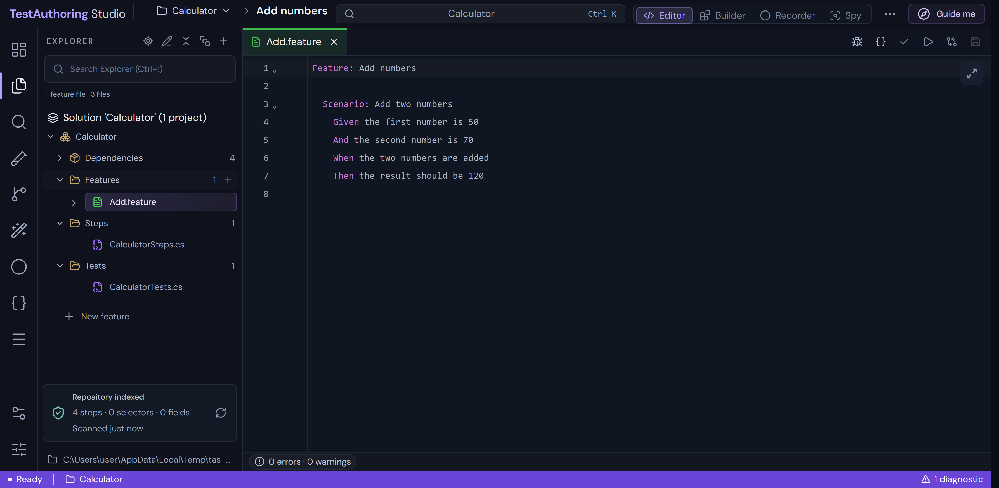
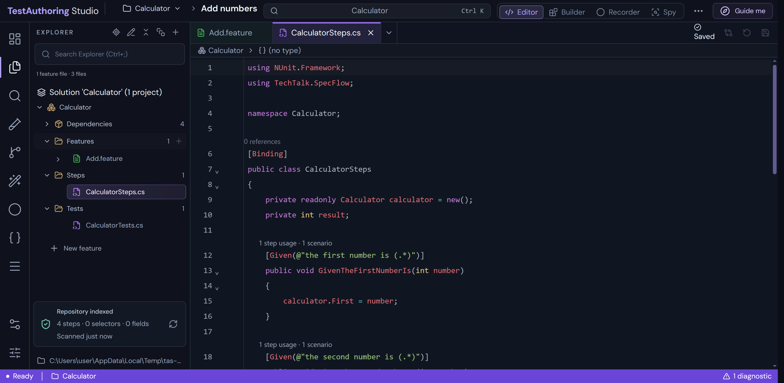
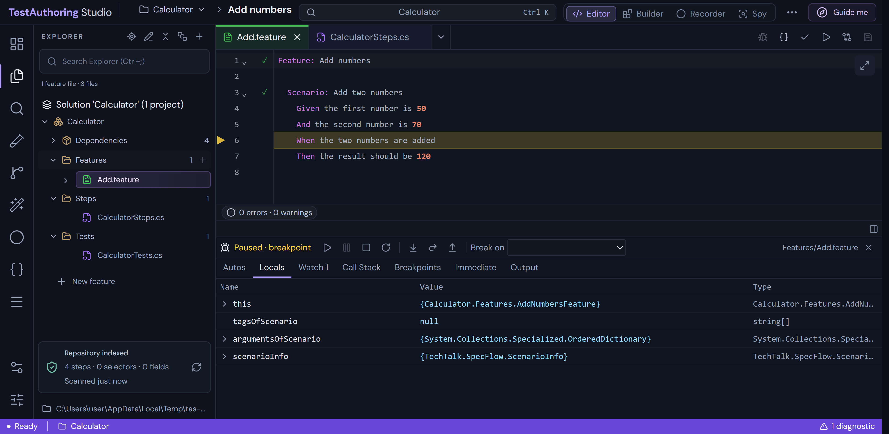
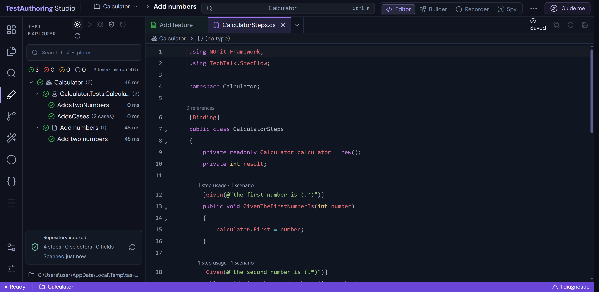
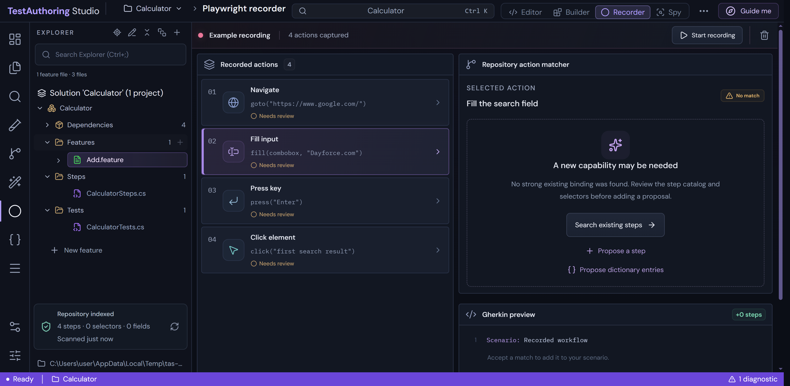
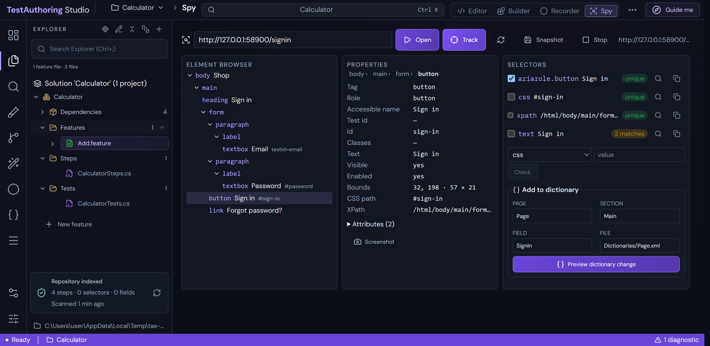
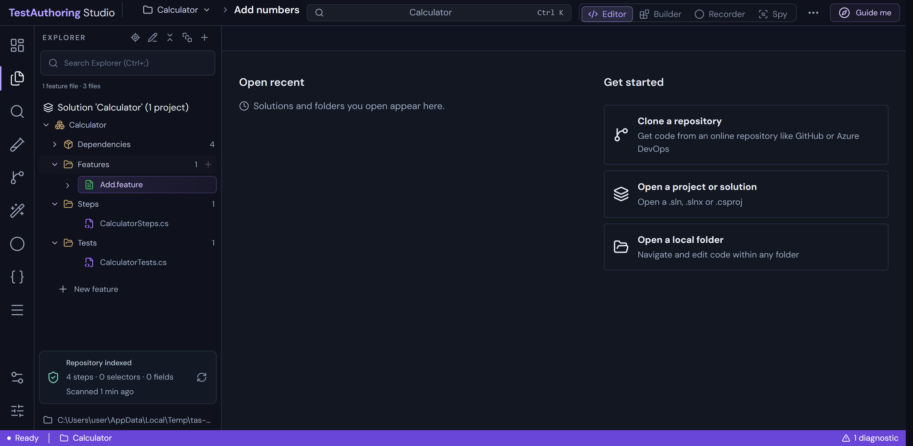

# TestAuthoring Studio

A local, Visual Studio–style IDE for **SpecFlow / Reqnroll + Playwright (C#)** test repositories. It indexes a .NET
test solution with Roslyn, and lets you write Gherkin features that reuse your existing step definitions, record
browser flows into feature files and XML selector dictionaries, edit and debug C#, and run tests. Everything runs on
your machine; nothing is uploaded.

It ships as a **Windows desktop app** (`test-authoring-desktop/`, Electron) and as a **web app**
(`test-authoring-studio/`, React + a local Node API), kept at feature parity.

## Screenshots

**Feature editor and Solution Explorer.** Open a `.sln` / `.slnx` / `.csproj`; projects, dependencies and files
appear as in Visual Studio.



**C# editor.** Roslyn IntelliSense, CodeLens (step usages, references, test results), go to definition, rename,
quick actions, and a navigation bar.



**Debugging a feature file.** Breakpoints on Gherkin lines, step into the C# step definition, then Locals, Watch,
Call Stack and Immediate.



**Test Explorer.** Discovers NUnit / xUnit / MSTest tests and scenarios. Run, debug, run failed, playlists and code
coverage.



**Playwright recorder.** Record a browser flow, match each action to existing steps, and generate the feature file
and dictionary entries.



**Spy (GUI object recognition, after Ranorex Spy).** Track an element on any page, browse the element tree, read its
properties, and pick a selector that is verified against the live page (unique / n matches) before it goes into an
XML dictionary. Snapshots keep a page to explore offline.



**Start Window.** Open recent, clone a repository, open a project, solution or folder.



## Highlights

- **Solutions:** `.sln` / `.slnx` / `.csproj`, multiple projects, NuGet package management, build, Error List and
  Output.
- **Gherkin:** step completion from your bindings, F12 to the step definition, table alignment as you type, Create
  Step, Rename Step.
- **C#:** IntelliSense, signature help, CodeLens, inlay hints, folding, sticky scroll, split editor, Git blame and
  compare.
- **Testing and debugging:** Test Explorer, run glyphs in the margin, netcoredbg debugging (conditional
  breakpoints, tracepoints, exception settings), code coverage, Playwright traces.
- **Git:** changes, stage, commit, branches, merge, fetch, pull and push.
- **Reqnroll / SpecFlow:** step matching with Reqnroll's rules (Cucumber expressions, `[Scope]` precedence,
  `[StepDefinition]`), Go To Hooks, Define Steps, Find Unused Step Definitions, bound/unbound step highlighting,
  Scenario Outline checks, and Gherkin formatting from `.editorconfig`. See [REQNROLL.md](REQNROLL.md).
- **Spy:** element tracking, element browser, properties, verified selectors, add to dictionary, snapshots. See
  [SPY.md](SPY.md).

Visual Studio feature parity is tracked in [VS2026-PARITY.md](VS2026-PARITY.md); current work is tracked in
[QOL-PROGRESS.md](QOL-PROGRESS.md).

## Getting started

```bash
# Web app (from test-authoring-studio/)
npm install
npm run scanner:build && npm run langserver:build && npm run debugger:setup
npm run dev            # http://localhost:5173

# Desktop app (from test-authoring-desktop/)
npm install
npm run dist           # release/TestAuthoring Studio Setup 1.0.0.exe (installer) and a portable exe
```

The .NET helpers need the .NET 10 SDK. The repository can use a local SDK in `.tools/dotnet/`. See
[CLAUDE.md](CLAUDE.md) for the architecture and development notes.

To refresh the screenshots after building the desktop app:

```bash
cd test-authoring-desktop
TAS_SCREENSHOTS=1 TAS_EXE="release/win-unpacked/TestAuthoring Studio.exe" npx playwright test screenshots
```
