# TestAuthoring Studio

A local IDE for **SpecFlow / Reqnroll + Playwright (C#)** test repositories, as a Windows desktop app
(`test-authoring-desktop/`) and a web app (`test-authoring-studio/`) at feature parity. Everything runs on your
machine; nothing is uploaded.

## Key advanced features

| Area | Feature | What it does |
| --- | --- | --- |
| Refactoring | **Change Signature** | Rename, remove and reorder parameters; every call site is updated, other files as diffs to approve. Also Reorder Parameters and Remove Unused Parameters. |
| Refactoring | **Structural refactorings** | Extract Method / Interface / Superclass, Introduce Variable / Parameter / Field / Property / Factory Method, Inline Field, Pull Members Up, Push Members Down, Move Static Members, Replace Constructor with Factory, LINQ to loop, method to local function. Refactor This (Ctrl+Alt+Shift+T) lists them for the selection. |
| C# | **Code generation and conversions** | `IEquatable<T>`, comparison members, `IAsyncDisposable`, equality, `ToString`, null checks, unit tests (NUnit, xUnit, MSTest); switch to expression, enum switch cases, tuple to named type, field to auto-property, record to class, interpolation to `string.Format`. |
| Analysis | **Roslyn analyzers** | The IDE analyzers in the editor, severities from `.editorconfig` / `.globalconfig`, exclusion scopes, a preview of each quick fix, and Fix All in the document or the solution. Dead code, unused members and redundant code are faded. |
| Analysis | **Solution analysis** | Duplicate code, namespace dependency cycles, layer rules from `layers.json`, control- and data-flow analysis, and Public API tracking against `PublicAPI.Shipped.txt` with breaking changes flagged. |
| Navigation | **Semantic search and decompiled sources** | Find symbols by kind, type, return type and attribute (`kind:method attr:Given`); go to metadata or decompiled source of framework and NuGet code; method and call hierarchies; peek references; named bookmark lists. |
| Search | **Search with Pattern** | Structural search and replace with `$placeholders$` and saved templates, previewed per file; search editors that can run again, multiline regex, case-preserving replace, search in the selection or in ignored files. |
| Debugging | **Breakpoints and inspection** | Conditional, dependent, temporary and function breakpoints, tracepoints, hit counts and labels; edit values while paused; Text, JSON, XML and table visualizers; pinned DataTips; inline values; Threads window. |
| Testing | **Coverage and test runs** | Line and branch coverage (partly covered lines in yellow, branch % per run), test history, Run Repeatedly, continuous testing on save, impacted tests from uncommitted changes, go to the next failure. |
| Git | **History editing and merges** | Interactive rebase (reword, squash, fixup, drop, reorder), squash to HEAD, a three-way merge editor, compare commits, worktrees, bisect, changelists, commit templates, inline blame, stage selected lines. |
| Projects | **Project Properties** | Property pages for a `.csproj` with effective values from the .NET SDK and `Directory.Build.props`; every change to a project file is a diff written only when you approve it. |
| Front end | **JavaScript, TypeScript, React, HTML, CSS** | A TypeScript language service with 40+ refactorings (type alias ⇄ interface, async ⇄ promises, CommonJS ⇄ ES modules, destructuring, `??`, JS to TS…), auto-imports and import updates on move; React actions (extract component, class to function component, props interfaces, Hooks dependency checks via eslint-plugin-react-hooks); HTML completion, validation, accessibility and ARIA checks; CSS / SCSS / LESS completion, colour picker, shorthands, specificity, partials and CSS Modules. See [FRONTEND-100.md](FRONTEND-100.md). |
| Editor | **VS Code settings** | A settings editor with a category tree, `settings.json` import / export and `@modified`; minimap with section headers, bracket pair guides, sticky scroll, rulers, word wrap, whitespace, semantic highlighting, inactive `#if` regions, format and organize usings on save. |
| Workbench | **Layout** | Editor groups (split right or down, move, lock, maximize), floating editor windows, Zen Mode, a secondary sidebar, activity bar and panel positions. |
| Workbench | **VS Code-style ease of use** | A resizable panel (drag its edge) with Maximize Panel Size, layout buttons and Back / Forward in the title bar, badges on the activity bar for Git changes and failed tests, index status in the status bar, double-click a tab to maximize the editor. See [GUI-QOL.md](GUI-QOL.md). |

Every optional feature has a switch under **Settings ▸ Features**. Progress and details:
[RIDER-VSCODE-FEATURES.md](RIDER-VSCODE-FEATURES.md), [FRONTEND-100.md](FRONTEND-100.md), [VSCODE-20.md](VSCODE-20.md), [ADVANCED-20.md](ADVANCED-20.md),
[CSHARP-20.md](CSHARP-20.md), [DEBUG-20.md](DEBUG-20.md), [REQNROLL.md](REQNROLL.md) and [SPY.md](SPY.md).

## Screenshots

Captured from the Windows desktop build on a temporary copy of the Calculator sample (running-app captures, not
mockups).

**Workbench.** Structure in a panel made taller by dragging its edge; layout buttons and Back / Forward in the title
bar; a badge with the pending Git changes on the activity bar; the index status in the status bar.

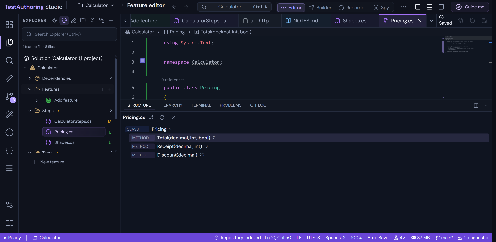

**Change Signature.** Rename a parameter, remove an unused one and move another up; the new signature updates as you
go, and call sites in other files come back as diffs.

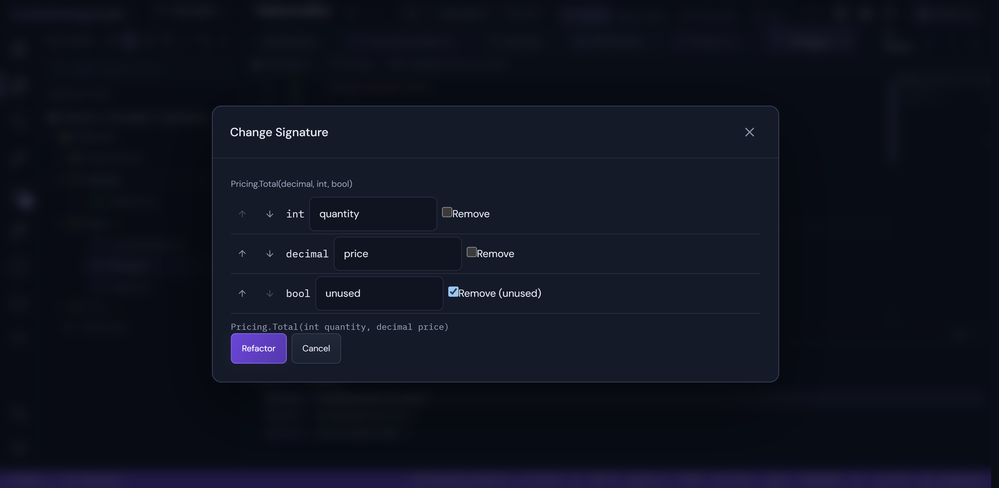

**C# refactoring.** Refactor This lists the refactorings for the selection. The gutter marks members that override
or are overridden, and the caret's line shows who changed it last.

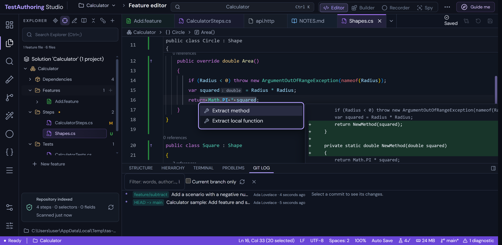

**Public API.** A saved baseline compared with the current code: removed and changed members are breaking changes,
added members are not.

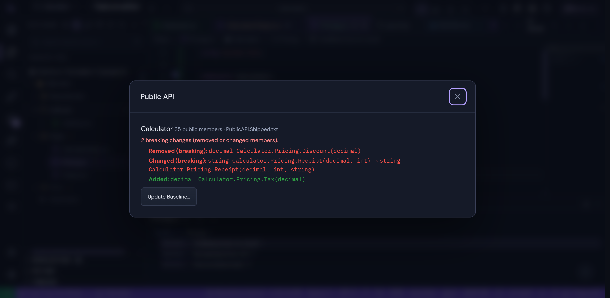

**Semantic search.** Symbols found by kind and attribute across the solution; select one to open it.

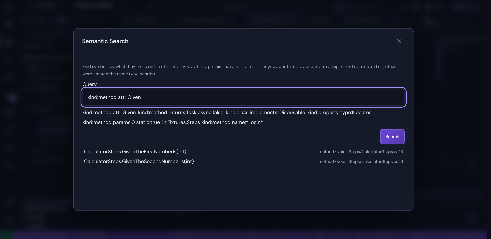

**Decompiled source.** Go to the implementation of a framework method, decompiled from its assembly.

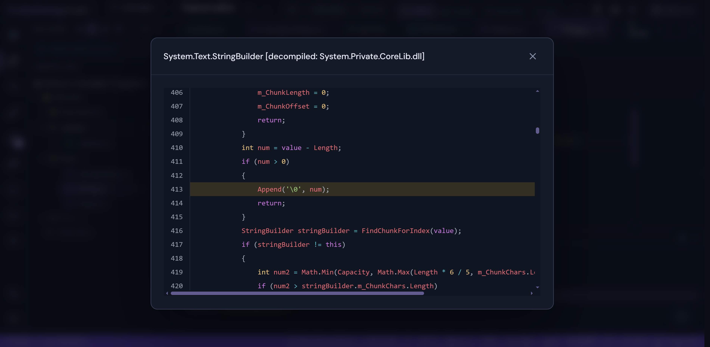

**Search with Pattern.** A structural search with placeholders across the solution, with a replacement to preview.

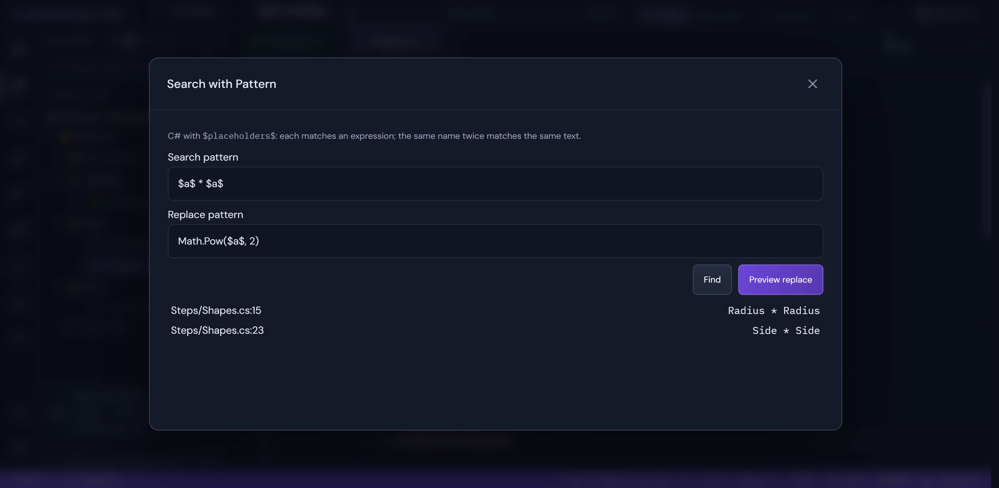

**Branch coverage.** One test takes one branch of two: the line is marked partly covered, and Test Explorer shows the
line and branch rates of the run.

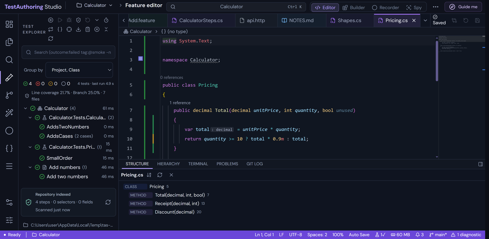

**Debugger visualizer.** Paused in a step definition: a list shown as a table, one row per item and a column per
property.

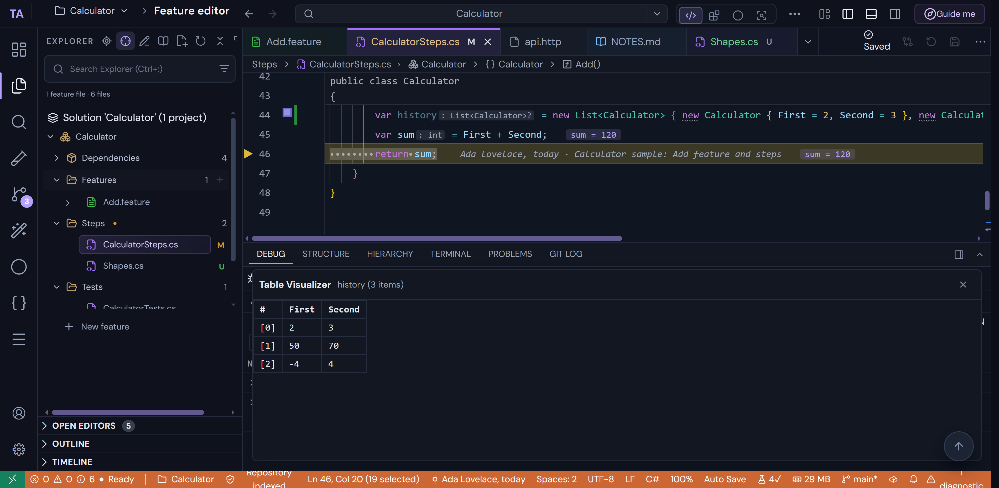

**Interactive rebase.** Plan a rebase from the Git Log: pick, reword, squash, fix up, drop or reorder commits. Here
the WIP commit is folded into the one before it and a later fix is moved up and dropped.

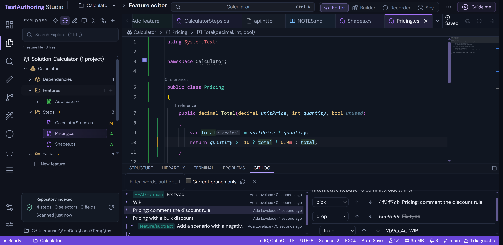

**Three-way merge editor.** Current and incoming changes beside the result, with Accept Current / Incoming / Both per
conflict and Complete Merge once none are left.

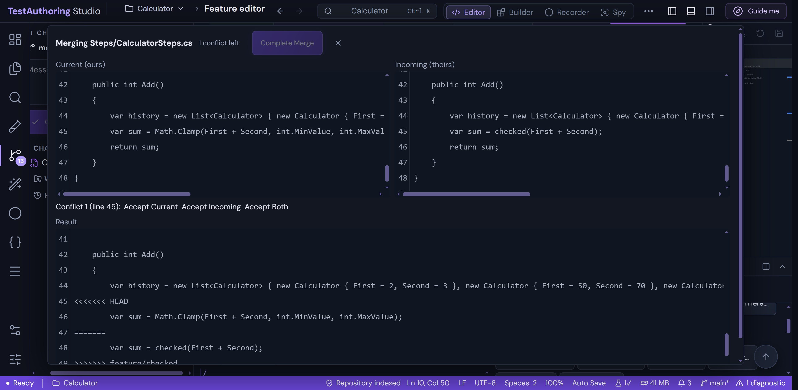

**Project Properties.** Settings the project file does not set show their effective value; changes are previewed as
a diff of the `.csproj`.

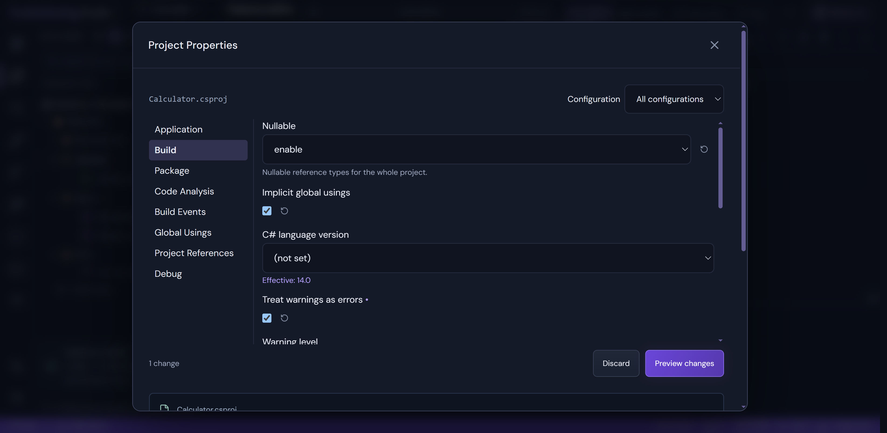

**Settings editor.** Categories as a tree (here Text Editor ▸ Minimap), with search, modified markers and
`settings.json`.

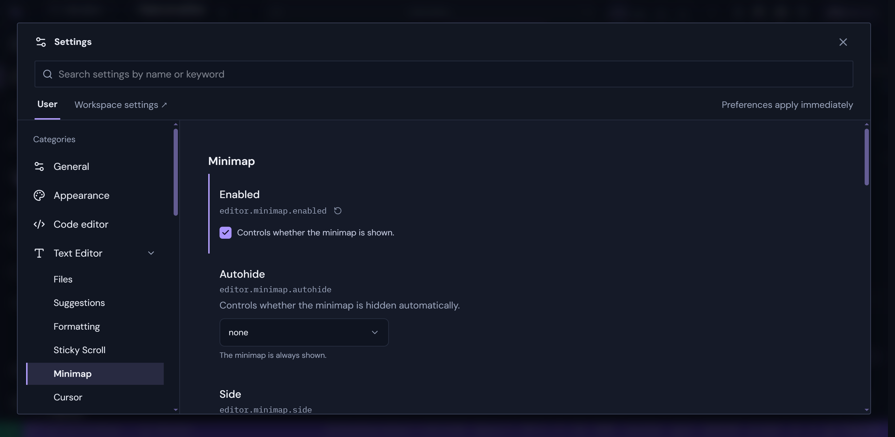

## Build

```bash
# Web app (from test-authoring-studio/): http://localhost:5173
npm install && npm run scanner:build && npm run langserver:build && npm run debugger:setup && npm run dev
# Desktop app (from test-authoring-desktop/): installer and portable exe in release/
npm install && npm run dist
```

The .NET helpers need the .NET 10 SDK (a local one in `.tools/dotnet/` works). Architecture notes: [CLAUDE.md](CLAUDE.md).
To refresh the screenshots, build the desktop app, then from `test-authoring-desktop/` run
`TAS_SCREENSHOTS=1 TAS_EXE="release/win-unpacked/TestAuthoring Studio.exe" npx playwright test screenshots`.
