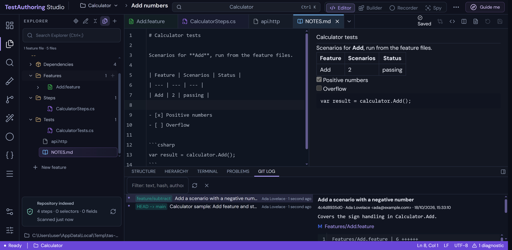

# TestAuthoring Studio — Desktop

The Electron (TypeScript) desktop version of [TestAuthoring Studio](../test-authoring-studio). It reuses the web app instead of forking it:

| Piece | Where it comes from |
| --- | --- |
| UI (React, CodeMirror, Test Design, every page) | The studio's `vite build` output, served unchanged |
| API (Express: scanning, matching, recorder, validation, writes) | The studio's `server/index.ts`, bundled with esbuild and run **inside the Electron main process** |
| Search worker | The studio's `server/search-worker.mjs`, bundled |
| C# scanner | The studio's Roslyn scanner, published **self-contained**, so users need no .NET install |
| Desktop-only code | `src/main` (main process), `src/preload` (bridge), `scripts/`, `tests/` |

The studio has three small host hooks: `STUDIO_ROOT` (resources), `STUDIO_DATA` (writable state) and `STUDIO_SCANNER_EXE` (self-contained scanner). It also has `src/desktop.ts`, which lights up native features when `window.desktop` exists and does nothing in a browser.

## Desktop screenshots

**Settings workbench — updated 2026-10-19**


Fresh captures of the packaged Windows app, taken on **2026-10-18** with the Calculator sample.

**Feature authoring and Solution Explorer**


**C# navigation and editing**


**Test discovery and run results**


**Debugging a Gherkin scenario**


**Git history and commit review**



See the [full screenshot gallery and capture instructions](../README.md#screenshots) and the
[60 proposed quality-of-life improvements](../DESKTOP-QOL.md), with priorities and acceptance criteria.

## Requirements

- Node.js 24+.
- The .NET 10 SDK, to publish the scanner. The studio's local SDK in `../.tools/dotnet` is used automatically. You only need it to build; the built app needs no .NET.
- Playwright Chromium (`npx playwright install chromium`), for recording and browser selector verification.

## Commands

```powershell
npm install
npm start          # build the studio client + API + scanner, then launch
npm run dev        # same, but reuse the existing studio client build
npm test           # Playwright _electron smoke tests (9) against the dev build
npm run pack       # unpacked build: release/win-unpacked/TestAuthoring Studio.exe
npm run dist       # Windows installer (NSIS) and portable .exe in release/
npm run typecheck
npm run test:packaged   # tests the packaged app copied outside the project, like a real install
```

To run the tests against the packaged app, set `TAS_EXE` first:

```powershell
$env:TAS_EXE='release/win-unpacked/TestAuthoring Studio.exe'; npx playwright test
```

The first build publishes the scanner into `.cache/scanner/<rid>`. Pass `--scanner` to `scripts/build.mjs` to republish it.

The desktop app has the same features as the web app, including the VS Code layout and the algorithm presets, because it serves the same UI. View → Layout and View → Algorithm Preset switch them from the menu.

## What the desktop app adds

- **Native menu.**
  - **File:** Open Repository… (Ctrl+Shift+O), Open Recent, New Feature (Ctrl+N), Start a Recording (Ctrl+Shift+R), Rescan (F5), Workspace Settings, Preferences (Ctrl+,).
  - **Edit:** the standard editing commands.
  - **View:** Command Palette (Ctrl+Shift+P), Basic/Advanced mode, explorer, focus mode, zoom, full screen, DevTools.
  - **Go:** every page (Alt+1…5), plus Back and Forward.
  - **Help:** Shortcuts (F1), Tour, Open Data Folder, Open Log File, About.
- **Repositories.**
  - Pick one with the native folder dialog, or drop a folder onto the window.
  - You can also pass one on the command line: `"TestAuthoring Studio.exe" C:\Source\Repo`.
  - Recent repositories appear in the menu and the Windows jump list.
  - Workspace settings get a **Browse…** button.
- **Source view.** **Open in default editor** and **Show in folder**. Both are confined to the repository.
- **Window.**
  - Remembers its size, position and maximized state (and recovers if a monitor is gone) and its zoom level.
  - Single instance: a second launch focuses the first window.
  - The title shows the page and the repository.
  - The native theme follows the studio theme.
- **Feedback.**
  - Taskbar progress while a scan or test run is working.
  - A notification when a test run finishes while the window is in the background.
- **State.** Workspace config, studio settings, traces, `desktop.json` and the log (`logs/studio.log`) live in the OS user-data folder, `%APPDATA%\TestAuthoring Studio` on Windows. Nothing is written beside the app.

## Security

- **Renderer isolation:** `contextIsolation`, `sandbox` and no `nodeIntegration`. The page only sees `window.desktop`, which is typed in `src/shared/bridge.ts`.
- **IPC checks:** every IPC handler checks that the sender is the app's own origin. File paths are resolved against the current repository and rejected if they fall outside it.
- **Links and navigation:** only `http(s)`/`mailto` links leave the app, and they open in the system browser. All other navigation is blocked. Permission requests are denied except clipboard, notifications and full screen.
- **Loopback API:** the API listens on `127.0.0.1` only, on a free port, and keeps the studio's host and origin checks.

## Layout

| Path | Contents |
| --- | --- |
| `src/main/main.ts` | Boot: single instance, window, loading page, API start, quit handling |
| `src/main/server.ts` | Free port, environment for the studio, in-process API import, health wait, log tee |
| `src/main/menu.ts` | Application menu and About dialog |
| `src/main/workspace.ts` | Open repository, recents, title, repository-confined file resolution |
| `src/main/ipc.ts` | Bridge handlers, sender validation, navigation and permission lock-down |
| `src/main/windowState.ts`, `store.ts` | Window bounds and small JSON state |
| `src/preload/preload.ts` | `window.desktop` |
| `scripts/build.mjs` | Builds the studio, bundles API/worker/main/preload, publishes the scanner, assembles `studio/` |
| `scripts/icon.mjs` | Renders the studio's `public/icon.svg` to `build/icon.png` |
| `tests/app.spec.ts` | Launch, API health, bridge isolation, menus, title, path confinement, navigation lock, theme, user-data location |

## Limits

- **Windows only for now.** Only Windows is packaged and tested. The code has macOS and Linux branches, such as the scanner runtime id and the app menu, but they are untested.
- **No code signing or auto-update.** Builds aren't code-signed and don't auto-update, so Windows SmartScreen will warn on first run.
- **Install size:** about 145 MB, mostly Electron and the self-contained .NET runtime for the scanner.
- **Recorder browsers:** the recorder uses the Playwright browsers in the user's cache (`%LOCALAPPDATA%\ms-playwright`). They are not bundled.
- **Run tests:** this still needs the .NET SDK, because it runs `dotnet test` on your repository.
